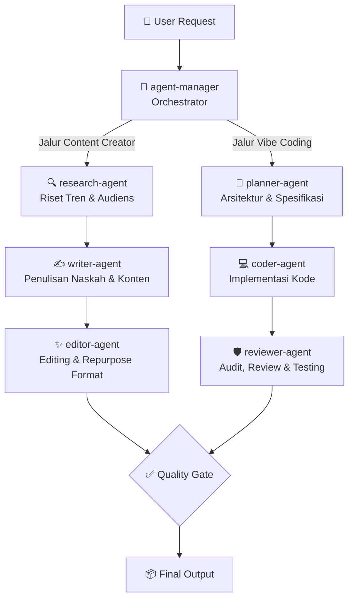

<div align="center">

# 🤖 Skill-Agent

**Sistem Multi-Agent Skills Profesional untuk Content Creator & Vibe Coding**

[](https://github.com/oziajayakan/Skill-Agent)
[](#-arsitektur-sistem)
[](https://saweria.co/kokbisaya)

</div>

---

## 📖 Tentang Proyek

**Skill-Agent** adalah kumpulan modular *Agent Skills* (`SKILL.md`) yang dirancang untuk mengubah AI coding assistant Anda menjadi tim spesialis yang terkoordinasi. Sistem ini membagi pekerjaan besar menjadi dua jalur utama—**Content Creator** dan **Vibe Coding**—yang dikelola oleh satu **Agent Manager (Orchestrator)**.

Setiap agent memiliki peran, batasan, dan standar kualitas yang jelas sehingga hasil akhir lebih konsisten, terstruktur, dan siap pakai.

---

## 🏗️ Arsitektur Sistem



---

## 🧩 Daftar Agent & Skill

| Jalur | Agent | Peran Utama | Direktori |
| :--- | :--- | :--- | :--- |
| **Orchestrator** | **Agent Manager** | Memecah tugas besar, mendelegasikan ke spesialis, melakukan *quality gate*, dan menyusun laporan akhir. | [`agent-manager/`](./agent-manager/SKILL.md) |
| **Content** | **Research Agent** | Mencari ide topik, tren terbaru, analisis kompetitor, dan riset audiens sebelum penulisan. | [`research-agent/`](./research-agent/SKILL.md) |
| **Content** | **Writer Agent** | Menulis naskah video (TikTok/Reels/Shorts), caption, thread, artikel, blog, dan newsletter. | [`writer-agent/`](./writer-agent/SKILL.md) |
| **Content** | **Editor Agent** | Memoles tata bahasa, kejelasan, alur, serta *repurpose* satu konten ke berbagai format platform. | [`editor-agent/`](./editor-agent/SKILL.md) |
| **Coding** | **Planner Agent** | Mengubah ide aplikasi/fitur menjadi spesifikasi teknis, struktur file, dan tahapan MVP. | [`planner-agent/`](./planner-agent/SKILL.md) |
| **Coding** | **Coder Agent** | Menulis, memperbaiki, dan mengembangkan kode secara bertahap sesuai spesifikasi. | [`coder-agent/`](./coder-agent/SKILL.md) |
| **Coding** | **Reviewer Agent** | Mengaudit kode, mencari bug, celah keamanan, dan memastikan kualitas sebelum dirilis. | [`reviewer-agent/`](./reviewer-agent/SKILL.md) |

> **Catatan:** `agent-manager` juga dilengkapi referensi tambahan di [`agent-manager/references/`](./agent-manager/references/) untuk standar *delegation brief* dan *quality gate*.

---

## 🚀 Cara Penggunaan

### 1. Clone Repository
```bash
git clone https://github.com/oziajayakan/Skill-Agent.git
```

### 2. Pasang ke Workspace / Global Skills
Salin folder agent yang Anda butuhkan ke direktori skills AI assistant Anda (misalnya `.agents/skills/` di proyek Anda):

```bash
# Contoh: menyalin semua skill ke direktori .agents/skills/ proyek Anda
cp -r Skill-Agent/* /path/to/your-project/.agents/skills/
```

### 3. Mulai Berinteraksi
Cukup berikan instruksi alami kepada AI Anda, misalnya:
- *"Buatkan rencana aplikasi kasir sederhana lalu langsung buatkan kodenya."* → otomatis memicu `agent-manager` → `planner-agent` → `coder-agent` → `reviewer-agent`.
- *"Cari tren konten AI minggu ini, buatkan script TikTok-nya, lalu ubah juga jadi thread X."* → otomatis memicu `research-agent` → `writer-agent` → `editor-agent`.

---

## ☕ Dukung Pengembangan

Jika kumpulan skill ini bermanfaat dan membantu produktivitas Anda, Anda dapat mendukung pengembangan proyek ini melalui Saweria:

<a href="https://saweria.co/kokbisaya" target="_blank">
  
</a>

👉 **[https://saweria.co/kokbisaya](https://saweria.co/kokbisaya)**

---

<div align="center">
  <sub>Dibuat dengan ❤️ oleh <a href="https://github.com/oziajayakan">oziajayakan</a></sub>
</div>
